<div align="center">


# Prune

**Your Mac is full of things you can rebuild. Prune finds them, proves they're safe, and gives the space back.**

Disk cleanup, code safety and security for developers, across every drive.

[](#install)
[](Package.swift)
[](LICENSE)
[](#safety)



</div>

---

## What it does

| | |
|---|---|
| 🧹 **Cleanup** | `node_modules`, `target/`, `.next`, DerivedData, caches, stale SDKs and emulators. Each comes with *why* and *what happens if you delete it*. |
| 💽 **Every drive** | Internal and external disks get their own scan, totals and suggestions. |
| 🔑 **Secrets** | API keys and `.env` files, checked against git: tracked, ignored or **already pushed**. |
| 🛟 **Code Backup** | Projects that exist only on this Mac: no git, no remote, unpushed work. |
| 🩺 **Project Doctor** | Broken venvs, worktrees and symlinks after moving projects, plus bloated repos. |
| 🛡️ **Security** | Launch agents, npm/pip packages, AI skills and MCP configs scored for malware patterns. |
| 📦 **Offload** | Move projects, apps and folders to an SSD, checksum-verified, with links left behind. |
| 🧩 **Apps & Extensions** | Leftover drivers, plug-ins and extensions, with a way to remove them. |
| 📈 **Timeline** | Free space over time and the day your disk fills up. |
| 🔧 **Maintenance** | DNS, Launch Services, Quick Look, Time Machine snapshots: explained, one click each. |

## See it work

### Every drive, its own suggestions
Switch between disks; projects on your external SSD get the same smart treatment.



### A leaked key, caught before it costs you
35+ key formats, plus an entropy score for anything assigned to a secret-sounding name. Values are masked and never stored.



### Offload without fear
Rebuildable caches are skipped, every file is verified, and a link keeps old paths working.



### Fix what moving broke
Old paths get relinked, and a leftover driver is removed step by step.



### Know before you run out



## Install

**Download:** grab `Prune.zip` from [Releases](../../releases), unzip, and drag **Prune** to Applications.
Prune updates itself from GitHub releases, after verifying a SHA-256 checksum and the code signature.

**Build from source** (Xcode 15+ command-line tools):

```bash
git clone https://github.com/alshell7/Prune.git && cd Prune
./build.sh --install
```

Then grant **Full Disk Access** (System Settings › Privacy & Security) for a complete scan.

## Safety

- **Nothing is deleted without your review.** Cleanups go to the Trash; quarantined items can be restored.
- **Git-aware.** Tracked files are never treated as junk, and source code that isn't backed up is flagged before any move or delete.
- **Guard rails.** System locations, volume roots, `.git` internals and personal libraries are refused outright.
- **Local only.** No telemetry, and nothing is uploaded. Update checks talk only to GitHub (switch them off in Settings); the OSV.dev malware lookup runs only when you click it.
- **Logged.** Every action is recorded in History (`~/Library/Logs/Prune/history.jsonl`).

## For the terminal

```bash
Prune --scan            # cleanup suggestions
Prune --secrets         # secrets & env files
Prune --doctor          # broken environments and links
Prune --code-backup     # what isn't pushed
Prune --security        # threat check
Prune --selftest-features   # run the checks
```

(`Prune` = `~/Applications/Prune.app/Contents/MacOS/Prune`)

## Release

`scripts/release.sh` builds, runs the self-tests, zips the app with its checksum, and publishes a GitHub release.

---

<div align="center">

Maintained by [**@alshell7**](https://github.com/alshell7) · [MIT License](LICENSE)

</div>
