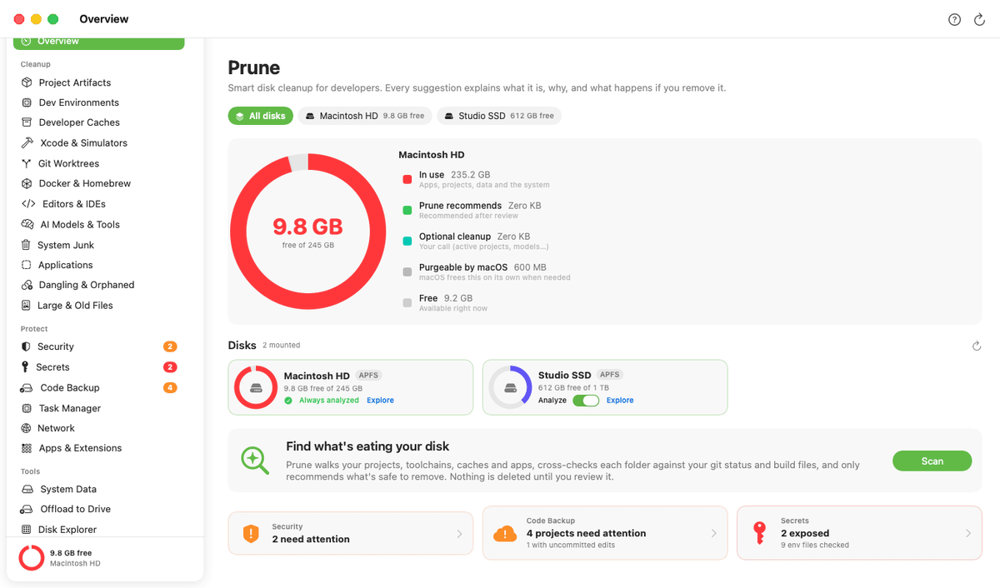
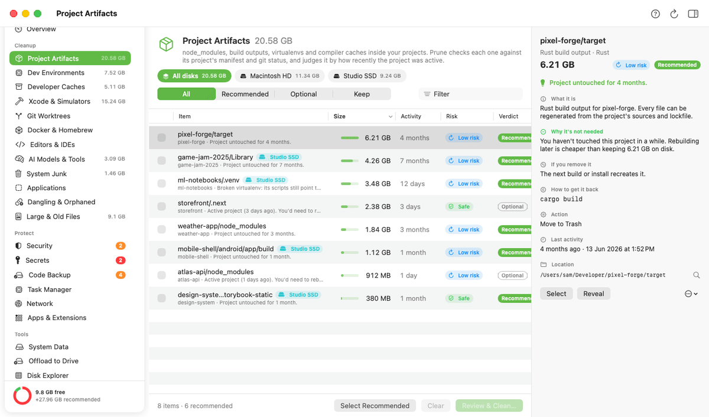
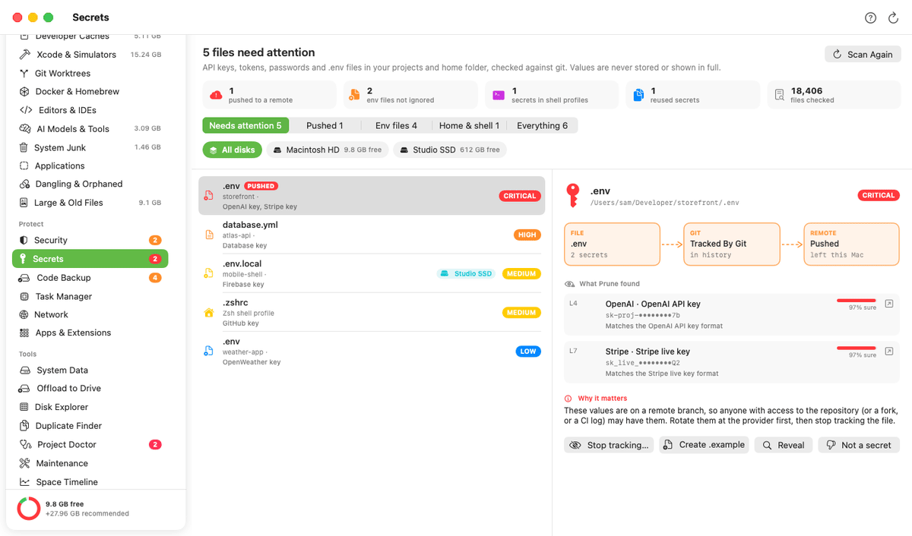
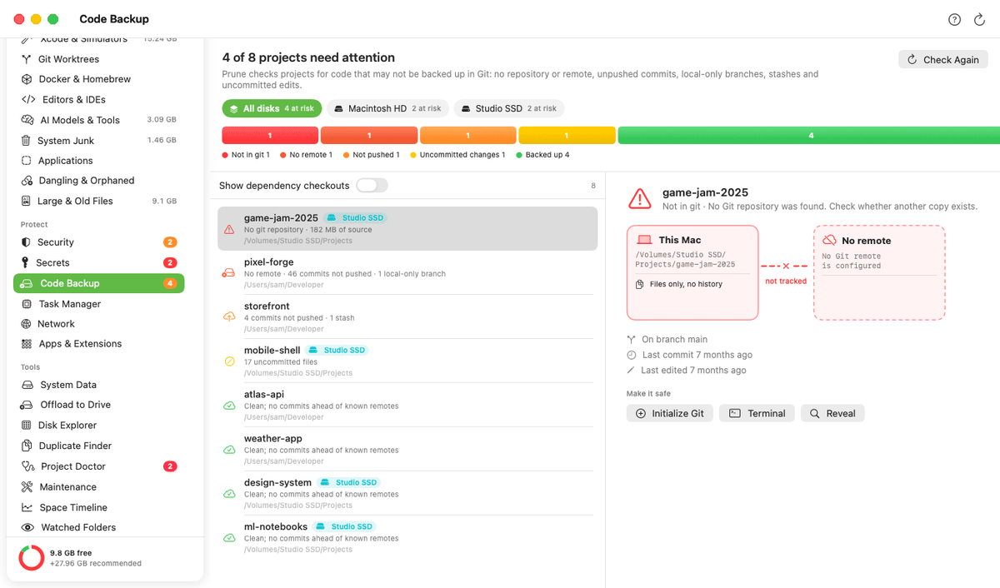
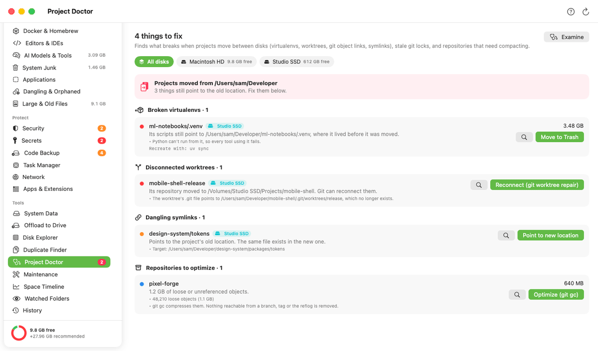
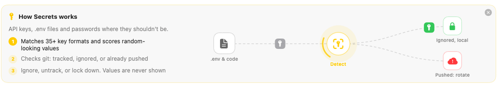
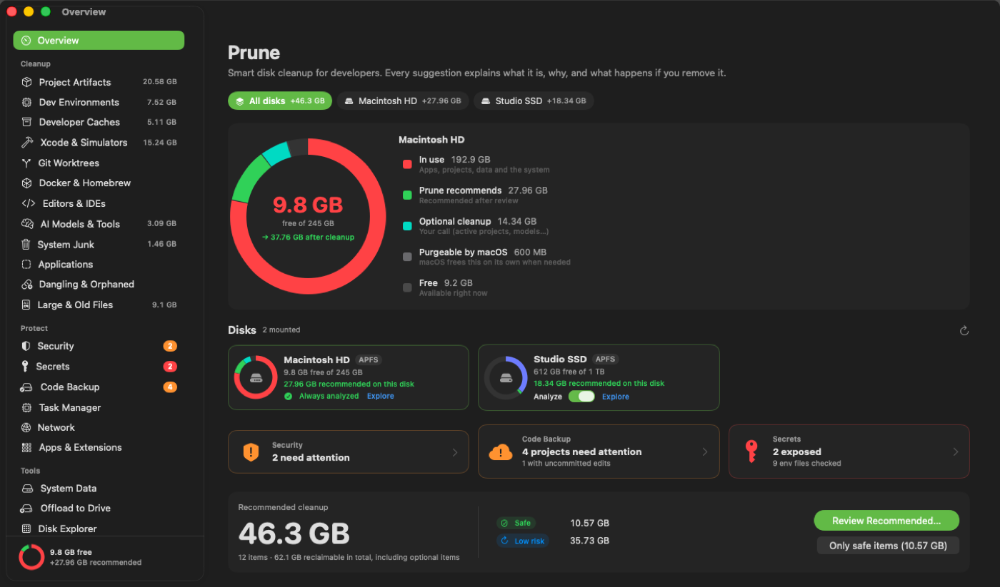
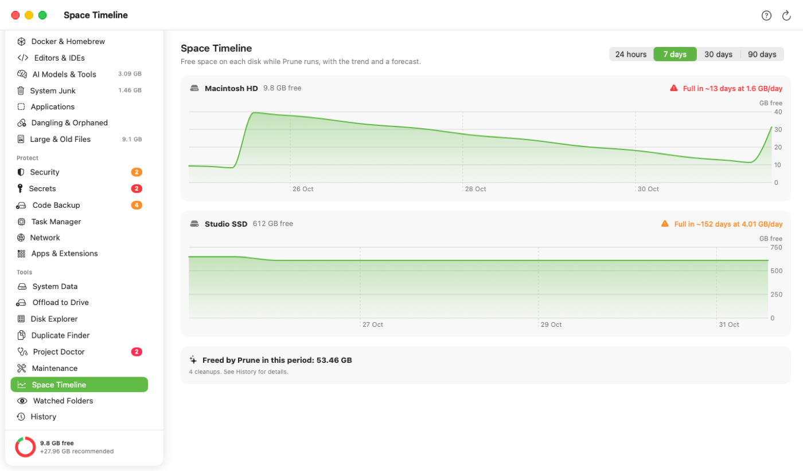

<div align="center">


# Prune

**Your Mac is full of things you can rebuild. Prune finds them, proves they're safe, and gives the space back.**

Disk cleanup, code safety and security for developers, across every drive.

[](https://github.com/alshell7/Prune/releases/latest)
[](#install)
[](LICENSE)
[](#safety)



<sub>Real app, recorded with demo data. Scan → review → 9.8 GB free becomes 31.4 GB.</sub>

</div>

## What it does

| | |
|---|---|
| 🧹 **Cleanup** | `node_modules`, `target/`, `.next`, DerivedData, caches, stale SDKs and emulators, each with *why* and *what happens if you delete it*. |
| 💽 **Every drive** | Internal and external disks each get their own scan, totals and suggestions. |
| 🔑 **Secrets** | API keys and `.env` files, checked against git: tracked, ignored or **already pushed**. |
| 🛟 **Code Backup** | Projects that exist only on this Mac: no git, no remote, unpushed work. |
| 🩺 **Project Doctor** | Broken venvs, worktrees and symlinks after moving projects, plus bloated repos. |
| 🛡️ **Security** | Launch agents, npm/pip packages, AI skills and MCP configs scored for malware patterns. |
| 📦 **Offload** | Move projects, apps and folders to an SSD, checksum-verified, with links left behind. |
| 🧩 **Apps & Extensions** | Leftover drivers, plug-ins and extensions, and a way to remove them. |
| 📈 **Timeline · 🔧 Maintenance** | When your disk fills up, plus one-click macOS fixes, each explained. |

## See it work

**Every drive gets its own suggestions.** Pick a disk; projects on your external SSD are judged the same way, down to a virtualenv that broke when it moved.



**A leaked key, caught.** 35+ key formats plus a randomness score, checked against git. Values are masked and never stored.



**Code that only lives here.** No git, no remote, unpushed commits, stashes.



**Fix what moving broke, and remove leftover drivers.**



**Every module explains itself.**



<table>
<tr>
<td></td>
<td></td>
</tr>
<tr>
<td align="center"><sub>Light, dark or system</sub></td>
<td align="center"><sub>Space Timeline: when you'll run out</sub></td>
</tr>
</table>

## Install

1. Download **[Prune.dmg](https://github.com/alshell7/Prune/releases/latest/download/Prune.dmg)** and drag Prune to Applications.
2. First launch: Prune isn't notarized yet, so macOS blocks it once. Click **Open Anyway** in System Settings › Privacy & Security.
3. Grant **Full Disk Access** in System Settings › Privacy & Security for a complete scan.

Prune updates itself from GitHub releases, verifying a SHA-256 checksum and the code signature first.

<details>
<summary>Build from source</summary>

```bash
git clone https://github.com/alshell7/Prune.git && cd Prune
./build.sh --install        # needs Xcode 15+ command-line tools
```

</details>

## Safety

- **You review everything.** Cleanups go to the Trash; quarantined items can be restored.
- **Git-aware.** Tracked files are never junk, and unbacked-up code is flagged before any move or delete.
- **Guard rails.** System locations, volume roots, `.git` internals and personal libraries are refused.
- **Local only.** No telemetry. Update checks talk only to GitHub (off in Settings).
- **Logged.** Every action is in History.

<details>
<summary>Terminal</summary>

```bash
P=/Applications/Prune.app/Contents/MacOS/Prune
$P --scan          # cleanup suggestions
$P --secrets       # secrets & env files
$P --doctor        # broken environments and links
$P --code-backup   # what isn't pushed
$P --security      # threat check
```

</details>

<details>
<summary>Maintainers</summary>

- `scripts/release.sh`: build, self-test, then publish `Prune.dmg`, `Prune.zip` and its checksum.
- `scripts/make_demos.sh`: re-record these GIFs from the real app with demo data.

</details>

<div align="center">

Maintained by [**@alshell7**](https://github.com/alshell7) · [MIT License](LICENSE)

</div>
